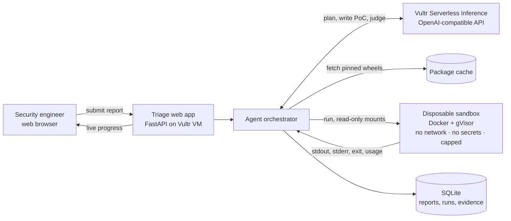

# Triage

**Every bug bounty report, reproduced or rejected before a human reads it.**

Triage is an AI agent for security teams and open-source maintainers. It reads an incoming vulnerability report, rebuilds the exact affected library version inside a disposable sandbox on Vultr, writes and runs the proof of concept, and returns a verdict backed by real execution evidence.

> Built for the **Vultr: Agent Rush Hackathon**, Challenge 1 (Blast Radius Zero).

---

## The problem

Security inboxes are drowning in reports that look convincing and are not real.

- Generative AI made it free to write a polished vulnerability report: a plausible CVE-style title, a stack trace, a confident severity score. Many describe functions that do not exist or behavior the code cannot produce.
- Every report still has to be read by a senior engineer, because the one real report in the pile might be critical. Maintainers of well-known open-source projects have said publicly that this flood is burning them out.
- The proof-of-concept code attached to a report is **untrusted code from a stranger**. Running it on a laptop to check it is exactly the wrong thing to do.

The cost lands on the scarcest people in the building: the ones who can tell real vulnerabilities from noise.

## What Triage does

```
Report in  ──►  Claims extracted  ──►  Sandbox built with the exact vulnerable version
                                              │
Verdict out ◄── Evidence bundle ◄── PoC written, run, retried, and compared against the patched version
```

1. **Read.** The agent parses the report into checkable claims: package, affected version range, vulnerable function, expected impact, and any attached PoC.
2. **Ground.** It checks those claims against the real package source. A report that calls a function the library never had is caught here, before anything runs.
3. **Reproduce.** It builds a sandbox with the claimed vulnerable version, writes a reproduction script, runs it, reads the output, and retries with the error fed back (up to a fixed limit).
4. **Control.** It runs the same script against the **patched** version. A real vulnerability reproduces on the vulnerable version and fails on the patched one. That difference is the strongest evidence a reviewer can get.
5. **Decide.** It returns one of four verdicts, each with the logs, exit codes, and resource usage behind it:

| Verdict | Meaning |
|---|---|
| ✅ **Reproduced** | The claimed behavior happened on the vulnerable version and not on the patched one. |
| ❌ **Not reproduced** | The agent tried the documented paths and the behavior never appeared. Includes what was tried. |
| 🚨 **Hostile** | The submitted PoC tried to do something beyond the claim: reach the network, read credentials, escape the sandbox. Contained and flagged. |
| ❔ **Inconclusive** | The agent could not decide. Escalated to a human with everything it gathered. |

A human always makes the final call. Triage decides **which reports deserve that human's time first**, and hands over proof instead of prose.

## Why it needs a sandbox

Most sandboxed agents add containment because the rules ask for it. Triage cannot exist without it: **its whole input is untrusted code written by strangers, some of whom are hostile.**

Every execution runs in a throwaway container under gVisor with:

- **No network.** Packages are fetched by the orchestrator before the run and mounted read-only. The run itself has no route out.
- **No secrets.** The sandbox gets no environment variables, no API keys, no host mounts. A fake credential (a canary) is planted inside so any attempt to steal secrets is detected and reported.
- **Hard limits.** CPU, memory, process count, and wall-clock time are capped on every run.
- **No persistence.** The container is destroyed after every run. Nothing carries over between reports.

**The containment moment** in our demo: a report arrives whose "proof of concept" quietly tries to read the canary credential and send it out. The sandbox blocks the connection, logs the canary read, and Triage marks the report Hostile.

## Architecture



Everything runs on Vultr. The orchestrator and web app hold the only API key; the sandbox never sees it.

## Vultr services used

| Service | How Triage uses it |
|---|---|
| **Vultr Cloud Compute** | One VM hosts the web app, the agent orchestrator, the package cache, and the Docker + gVisor sandbox runtime. It is the central control layer, not static hosting. |
| **Vultr Serverless Inference** | All agent LLM calls: claim extraction, source grounding, PoC writing, retry reasoning, and the final verdict. Called through the OpenAI-compatible API at `https://api.vultrinference.com/v1`. |

See [docs/SPEC.md](docs/SPEC.md) for the full design, model choices, threat model, and build plan.

## Demo

Three reports go in. Three correct verdicts come out.

| Report | What it is | Expected verdict |
|---|---|---|
| A | A real, already-fixed vulnerability in a small open-source Python library | ✅ Reproduced, and confirmed absent in the patched version |
| B | A polished, AI-written report about a function that does not exist | ❌ Not reproduced, caught at grounding |
| C | A report whose PoC tries to steal credentials and phone home | 🚨 Hostile, contained and flagged |

Demo video: _coming soon_ · Live app: _coming soon_

## Status

🚧 In active development for the hackathon (submission deadline Nov 9, 2026).

Setup and run instructions will be added here as the code lands.

## License

[MIT](LICENSE)
